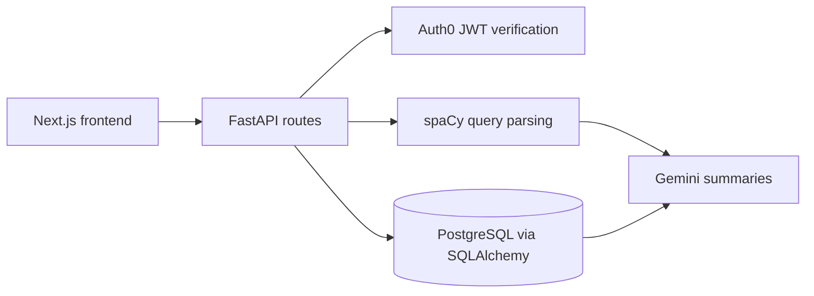

# EstateWise AI - HackUTD2025

EstateWise AI is a real-estate portfolio insights prototype. The repository contains a Next.js interface for property and portfolio workflows and a FastAPI service for property, lease, and operational data, authentication routes, and natural-language analysis.

The interface also uses sample portfolio data. There is no public demo URL configured in this repository.

## What it does

- Presents real-estate investment and portfolio views for property and lease information.
- Defines API routes for properties, leases, dashboard totals, user and manager chat, and manager dashboards.
- Uses SQLAlchemy models backed by PostgreSQL for property, lease, and monthly operations records.
- Includes Auth0 JWT verification for protected API routes.
- Uses spaCy parsing and a Google Gemini client to summarize matching database results and suggest follow-up actions.

## Stack

- **Frontend:** Next.js 16, React 19, Tailwind CSS 4, Recharts
- **API:** Python, FastAPI, SQLAlchemy
- **Data:** PostgreSQL
- **AI and language processing:** Google Gen AI SDK, spaCy (`en_core_web_sm`)
- **Authentication:** Auth0 JWT validation

## Architecture



The frontend and backend are separate development services. The API reads property and lease data from PostgreSQL; selected query results are passed to the language layer for summaries.

## Run locally

### Frontend

Requires Node.js and npm. From the repository root:

```bash
npm install
npm run dev
```

The Next.js development server normally opens at `http://localhost:3000`.

### Backend

Requires Python, PostgreSQL, and the environment values listed below. No Python dependency lock or requirements file is included, so install the API dependencies in a virtual environment:

```bash
python -m venv .venv
source .venv/bin/activate
pip install fastapi uvicorn sqlalchemy psycopg2-binary python-dotenv "python-jose[cryptography]" google-genai spacy
python -m spacy download en_core_web_sm
```

On Windows PowerShell, activate the environment with `.venv\Scripts\Activate.ps1`.

Create a local `.env` in the repository root and configure these variable names without committing secrets:

```dotenv
FRONTEND_URL=http://localhost:3000
POSTGRES_USER=your_user
POSTGRES_PASSWORD=your_password
POSTGRES_HOST=localhost
POSTGRES_PORT=5432
POSTGRES_DB=your_database
GEMINI_API_KEY=your_key
AUTH0_DOMAIN=your_tenant_domain
CLIENT_ID=your_client_id
API_AUDIENCE=your_api_audience
ALGORITHMS=RS256
```

Start the API from the repository root:

```bash
uvicorn backend.main:app --reload
```

The API defaults to port `8000`. Set up the matching Auth0 application and PostgreSQL database before using authenticated or data-backed routes.

## Demo

No public demo URL is listed.

## Repository

[furkmez20/HackUTD2025](https://github.com/furkmez20/HackUTD2025)
